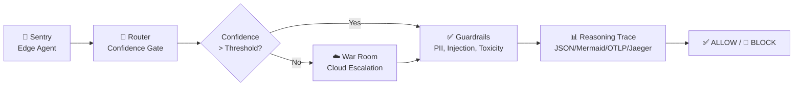

# Aegis Lite

**AI Governance & Trust Layer for Hybrid Intelligence Systems**

[](https://python.org)
[](LICENSE)
[]()
[]()

---

## 🎯 Problem

Organizations deploying AI agents face critical governance challenges:

| Challenge | Impact |
|-----------|--------|
| **Uncontrolled autonomy** | Agents make high-stakes decisions without oversight |
| **No confidence scoring** | Can't distinguish reliable from hallucinated outputs |
| **Safety gaps** | PII leakage, prompt injection, toxicity undetected |
| **Audit blindness** | No traceability for compliance (GDPR, HIPAA, SOC2) |
| **Scaling blindly** | No load testing or SLA validation before production |

---

## 💡 Solution

**Aegis Lite** provides a complete governance layer for hybrid AI systems:



### Key Capabilities

| Component | Purpose | Features |
|-----------|---------|----------|
| **AgentRegistry** | Service discovery & health | Type-indexed, health checks, callbacks |
| **ConfidenceGate** | Decision routing | Multi-scorer, calibration, adaptive thresholds |
| **SafetyGuardrails** | Deterministic safety | PII, prompt injection, toxicity, hallucination, bias, copyright |
| **ReasoningTrace** | XAI observability | Multi-format export, sampling, compression |
| **StressTest** | Resilience validation | 6 scenarios, fault injection, SLA validation |
| **RigorMode** | Config-driven scope | demo / standard / enterprise |

---

## 🚀 Quick Start

### Installation
```bash
git clone https://github.com/raulrodriguezmesia-blip/eros-ai.git
cd eros-ai
pip install -e .
```

### Run the Demo
```bash
# Full demonstration (4 scenarios)
python -m eros.cli.rigor_ctl demo

# Low confidence escalation only
python -m eros.cli.rigor_ctl demo --scenario escalation

# JSON output for automation
python -m eros.cli.rigor_ctl demo --format json
```

### Run Integration Tests
```bash
# Golden Path E2E test
pytest tests/integration/test_golden_path.py -v

# All tests
pytest -v
```

### Launch Dashboard
```bash
streamlit run dashboard.py
```

---

## 🏗️ Architecture

### Hybrid Intelligence Flow

```
┌─────────────────────────────────────────────────────────────────┐
│                        AEGIS LITE PIPELINE                       │
├─────────────────────────────────────────────────────────────────┤
│                                                                  │
│  REQUEST                                                         │
│    │                                                             │
│    ▼                                                             │
│  ┌─────────────┐    ┌─────────────┐    ┌─────────────────┐      │
│  │   SENTRY    │───▶│   ROUTER    │───▶│ CONFIDENCE GATE │      │
│  │  (Edge)     │    │             │    │  • Self-consist │      │
│  │  • Local    │    │  • Select   │    │  • Probabilistic│      │
│  │  • Telemetry│    │  • Route    │    │  • Calibration  │      │
│  └─────────────┘    └─────────────┘    └────────┬────────┘      │
│                                                  │               │
│                    ┌─────────────────────────────┘               │
│                    ▼                                              │
│              ┌─────────────┐    ┌─────────────────┐              │
│              │   LOW       │───▶│    WAR ROOM     │              │
│              │ CONFIDENCE  │    │   (Cloud)       │              │
│              │  FALLBACK   │    │  • Heavy LLM    │              │
│              └─────────────┘    │  • GPU A100     │              │
│                                └────────┬────────┘              │
│                                         │                       │
│                    ┌────────────────────┘                       │
│                    ▼                                              │
│              ┌─────────────────┐    ┌─────────────────┐         │
│              │  GUARDRAILS     │───▶│ REASONING TRACE │         │
│              │  • PII          │    │  • JSON         │         │
│              │  • Injection    │    │  • Mermaid      │         │
│              │  • Toxicity     │    │  • OTLP/Jaeger  │         │
│              │  • Hallucination│    └────────┬────────┘         │
│              └────────┬────────┘             │                 │
│                       ▼                       ▼                 │
│              ┌─────────────────────────────────────────┐       │
│              │           DECISION                      │       │
│              │  ✅ ALLOW  |  🚫 BLOCK  |  ⬆️ ESCALATE   │       │
│              └─────────────────────────────────────────┘       │
└─────────────────────────────────────────────────────────────────┘
```

### Rigor Modes (Config-Driven Scope)

| Feature | `demo` | `standard` | `enterprise` |
|---------|--------|------------|--------------|
| Max Agents | 3 | 10 | 100 |
| Persistence | Memory | SQLite | PostgreSQL |
| Guardrail Rules | 2 | 4 | 6 |
| Action | Log | Block | Block + Alert |
| Trace Formats | JSON | JSON, Mermaid, OTLP | All + Jaeger |
| Stress Scenarios | 2 | 4 | 6 |
| CLI Commands | 4 | 6 | 8 |
| Compliance | - | - | GDPR, HIPAA, SOC2 |

**Switch modes:** `export AEGIS_RIGOR_MODE=standard` or edit `rigor.yaml`

---

## 📦 Components

### 1. AgentRegistry (`eros/agent_registry.py`)
```python
from eros import get_registry, AgentType

registry = await get_registry()

agent_id = await registry.register(
    name="RiskAnalyzer",
    agent_type=AgentType.WAR_ROOM,
    endpoint="https://api.example.com",
    capabilities=["financial_analysis", "risk_scoring"],
)
```

**Features:** Type-indexed registration, health monitoring, async callbacks, graceful shutdown.

### 2. ConfidenceGate (`eros/confidence_gate.py`)
```python
from eros import get_confidence_gate

gate = get_confidence_gate()

decision = await gate.evaluate(
    {"query": "Analyze portfolio risk"},
    context={"agent_id": "war-room-001"},
    scorer_name="probabilistic",
)

if decision.allowed:
    print(f"Confidence: {decision.confidence.value:.2f}")
else:
    print(f"Fallback: {decision.fallback.value}")
```

**Scorers:** Self-consistency (LLM), Probabilistic (logits), extensible interface.
**Features:** Calibration (Platt scaling), adaptive thresholds, audit trail.

### 3. SafetyGuardrails (`eros/safety_guardrails.py`)
```python
from eros import get_safety_guardrails

guardrails = get_safety_guardrails()

# Check any text
allowed, results = await guardrails.check_async(
    "My email is john@company.com and SSN 123-45-6789",
    context={"agent_id": "sentry-001"}
)

for r in results:
    if r.triggered:
        print(f"BLOCKED: {r.rule_name} ({r.action.value})")
```

**Detectors:** PII, Toxicity, Prompt Injection, Hallucination, Bias, Copyright
**Actions:** Log, Block, Block & Alert
**Compliance:** GDPR, HIPAA, SOC2 ready

### 4. ReasoningTrace (`eros/reasoning_trace.py`)
```python
from eros import get_reasoning_trace, TraceEventType

trace = get_reasoning_trace()

ctx = trace.start_trace("agent-001", session_id="session-123")
trace.add_event(TraceEventType.DECISION, agent_id="agent-001", data={"input": "..."})
trace.end_trace(ctx)

# Export in multiple formats
json_out = await trace.export(ctx.trace_id, "json")
mermaid_out = await trace.export(ctx.trace_id, "mermaid")
otlp_out = await trace.export(ctx.trace_id, "opentelemetry")
```

**Formats:** JSON, Mermaid diagrams, OpenTelemetry (OTLP), Jaeger
**Features:** Context-aware, sampling, compression, PII redaction

### 5. StressTest (`eros/stress_test.py`)
```python
from eros import get_stress_test, StressScenario

stress = get_stress_test()

result = await stress.run_scenario(
    StressScenario.LOAD,
    my_target_function,
    {"concurrent": 100, "duration_sec": 300, "ramp_up_sec": 30}
)

print(f"P99: {result.latency_p99_ms:.1f}ms")
print(f"Error rate: {result.error_rate:.2%}")
print(f"SLA violations: {len(result.sla_violations)}")
```

**Scenarios:** Load, Latency, Fault Injection, Chaos, Soak, Spike
**Faults:** Network delay, errors, timeouts, agent crashes, resource exhaustion
**SLA:** P99 latency, error rate, throughput thresholds

---

## 🧪 Testing

### Integration Test (Golden Path)
```bash
pytest tests/integration/test_golden_path.py -v -s
```

Validates:
- ✅ Agent registration (4 agents)
- ✅ Normal request → Confidence Gate → Guardrails → ALLOW
- ✅ Low confidence → Escalation → War Room → ALLOW
- ✅ Prompt injection → BLOCKED
- ✅ PII detection → BLOCKED
- ✅ Stress test (6,800+ req/s, 100% success)
- ✅ Multi-format trace export
- ✅ Audit & compliance logging

### Unit Tests
```bash
pytest tests/unit/ -v
```

---

## 📊 Dashboard

Real-time observability dashboard built with Streamlit:

```bash
streamlit run dashboard.py
```

**Displays:**
- Active agents, confidence %, risk alerts, traces, P99 latency
- Pipeline visualization (Sentry → Router → Guardrails → Trace → Decision)
- Agent registry with health status
- Confidence thresholds & distribution
- Guardrail rules & recent events
- Trace export format availability
- Stress test results with SLA compliance

---

## ⚙️ Configuration

### rigor.yaml (Mode-First Structure)
```yaml
rigor:
  mode: "standard"  # demo | standard | enterprise
  
  standard:
    agent_registry:
      max_agents: 10
      persistence: "sqlite"
    confidence_gate:
      min_confidence: 0.75
      fallback: "escalate"
      calibration_enabled: true
    safety_guardrails:
      rules: ["pii_detection", "toxicity", "prompt_injection", "hallucination"]
      action: "block"
    # ... more components
```

### Environment Overrides
```bash
export AEGIS_RIGOR_MODE=enterprise
export AEGIS_RIGOR_CONFIG=/path/to/custom/rigor.yaml
```

---

## 🎯 Hackathon Demo Script

### 60-Second Pitch
```bash
# 1. Show architecture
python -m eros.cli.rigor_ctl demo

# 2. Prove resilience
python -m eros.cli.rigor_ctl benchmark load --concurrent 100 --duration 30

# 3. Show compliance
python -m eros.cli.rigor_ctl audit --framework GDPR
```

### Key Differentiators to Highlight
1. **Hybrid Intelligence** - Edge confidence routing with cloud fallback
2. **Deterministic Guardrails** - Not probabilistic, rules-based blocking
3. **Full Observability** - XAI traces in 4 formats (JSON/Mermaid/OTLP/Jaeger)
4. **Config-Driven Scope** - One codebase, three rigor modes
5. **Production Ready** - Stress tested, auditable, compliant

---

## 📁 Project Structure

```
eros-ai/
├── rigor.yaml                 # Configuration (mode-first)
├── dashboard.py               # Streamlit observability dashboard
├── src/
│   └── eros/
│       ├── __init__.py        # Exports all public APIs
│       ├── rigor.py           # RigorMode config loader
│       ├── agent_registry.py  # AgentRegistry + health monitoring
│       ├── confidence_gate.py # ConfidenceGate + scorers
│       ├── reasoning_trace.py # ReasoningTrace + exporters
│       ├── stress_test.py     # StressTest + fault injector
│       ├── safety_guardrails.py # 6 detectors + actions
│       └── cli/
│           ├── __init__.py
│           └── rigor_ctl.py   # CLI: register, invoke, trace, health, demo, benchmark, audit, policy
├── tests/
│   ├── integration/
│   │   └── test_golden_path.py  # E2E Golden Path test
│   └── unit/                    # Unit tests (to be added)
└── README.md
```

---

## 🗺️ Roadmap

- [ ] Unit tests for each component (90%+ coverage)
- [ ] Prometheus/Grafana metrics export
- [ ] Kubernetes operator for AgentRegistry
- [ ] WebSocket streaming for real-time traces
- [ ] Policy-as-code (OPA/Rego integration)
- [ ] Multi-region War Room failover

---

## 📄 License

MIT License - see [LICENSE](LICENSE) for details.

---

## 🤝 Contributing

1. Fork the repository
2. Create feature branch (`git checkout -b feature/amazing`)
3. Run tests (`pytest -v`)
4. Submit PR

---

## 🙏 Acknowledgments

Built for **Microsoft Agents League Hackathon** & **#BuildHybridAI 2026**

**Architecture:** Edge → Router → Cloud → Guardrails → Trace → Decision

**Mantra:** *Code → Evidence → Demo → Storytelling*